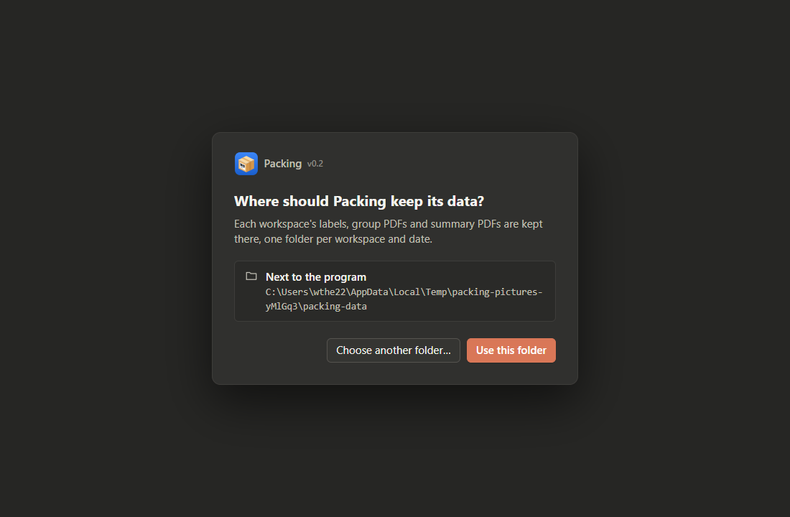

# Setting up the program

The app **Packing** runs on a Windows PC. It takes the *Shipping label + Packing slip* PDFs of one
download from the seller centre, sorts the orders into label groups, and writes one group PDF per group
plus one summary PDF to print. No terminal is needed.

## Set up the program folder

The app is one folder, not an installed program.

1. Copy the folder `Packing` (the output of `tools/make-portable.sh`, found in
   `target/portable/Packing/`, or the folder you were given) to a place you can write to, for
   example `D:\Packing\`. **Do not** put it under `C:\Program Files` — Windows does not let the app
   write there.
2. The folder must contain `Packing.exe` (the program) and `pdfium.dll` (the PDF reader it uses).
3. Make a shortcut to `Packing.exe` on the Desktop or the taskbar: right-click `Packing.exe` →
   *Show more options* → *Send to* → *Desktop (create shortcut)*. Start the program from the shortcut.

Beside the program the app keeps two files of yours: `packing-settings.toml` (where the data is kept)
and `packing-workflows.toml` (the couriers and the sort rules). Copying the whole folder to another PC
moves the program and all its data along.

## The first start

The first time, the app asks **Where should the data be kept?**

- **Use the folder next to the program** keeps the data in `packing-data` beside the program. Choose this for a
  normal setup.
- **Choose a folder…** picks another folder, e.g. when the program folder cannot be written.

Then it asks to **name the first workspace**. A workspace keeps its batches and dates apart from every
other workspace — for example one per shop owner. Type a name (e.g. *Toko Contoh*) and press
**Use this name**; the Day screen of today opens. More workspaces are added in the panel.

## A new version of the program

Close the app, then copy the new `Packing.exe` and `pdfium.dll` over the old ones. Your two files and
the `packing-data` folder stay as they are.

A data folder used by version 0.1 (with `labels\`, `state.json`, `categories.toml`) is not read by this
version and never deleted: the Day screen says so with **Open folder**.
