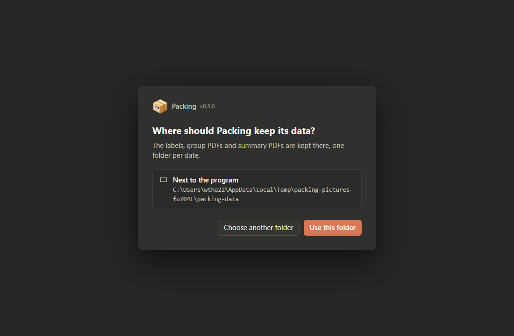

# Setting up the program

The app **Packing** runs on a Windows PC. It takes the *Shipping label + Packing slip* PDFs of one
download from the seller centre, sorts the orders into label groups, and writes one group PDF per group
plus one summary PDF to print. No terminal is needed.

## Set up the program folder

The app is one folder, not an installed program.

1. Copy the folder `Packing` (the output of `tools/make-portable.sh`, found in
   `target/portable/Packing/`, or the folder you were given) to a place you can write to, for
   example `D:\Packing\`. **Do not** put it under `C:\Program Files` — Windows does not let the app
   write there.
2. The folder must contain `Packing.exe` (the program) and `pdfium.dll` (the PDF reader it uses).
3. Make a shortcut to `Packing.exe` on the Desktop or the taskbar: right-click `Packing.exe` →
   *Show more options* → *Send to* → *Desktop (create shortcut)*. Start the program from the shortcut.

Beside the program the app keeps one file of yours, `packing-app.toml` (where the data is kept, and the
theme). Two more are in the data folder: `parser.toml` (the couriers and how the app tells them apart) and
`config.toml` (the accounts with their shops, and the sort rules). Copying the whole folder to another PC
moves the program and all its data along; pointing a second PC at the same data folder shares the accounts
and the sort rules too.

## The first start

The first time, the app asks **Where should Packing keep its data?**

- **Use this folder** keeps the data in `packing-data` beside the program (*Next to the program*).
  Choose this for a normal setup.
- **Choose a folder** picks another folder, e.g. when the program folder cannot be written.

Nothing more is asked: the Day screen of today opens. An **account** is one shop owner's shops: a name and
the shop names its labels are sent by. The app learns them when labels are first read
([The shop prompt](02-a-day.md#the-shop-prompt)); they can also be made ahead on the **Accounts** screen
([Accounts](03-changes.md#accounts)). The data folder holds one folder per date, for every account.

## Several PCs on one data folder

More than one person can work at the same time: start Packing on each PC with the same data folder
(e.g. a shared network folder chosen with **Choose a folder**, or the same program folder). Each copy
shows what the others save within a few seconds. When two save at the same moment, one waits for the
other; if the other saved some of the same orders, Packing asks to read the labels again.

## A new version of the program

Close the app, then copy the new `Packing.exe` and `pdfium.dll` over the old ones. Your two files and
the `packing-data` folder stay as they are.

A data folder used by version 0.1 (with `labels\`, `state.json`, `categories.toml`) or by version 0.4
(one folder per shop owner) is not read by this version and never deleted: the Day screen says so with
**Open folder**.
