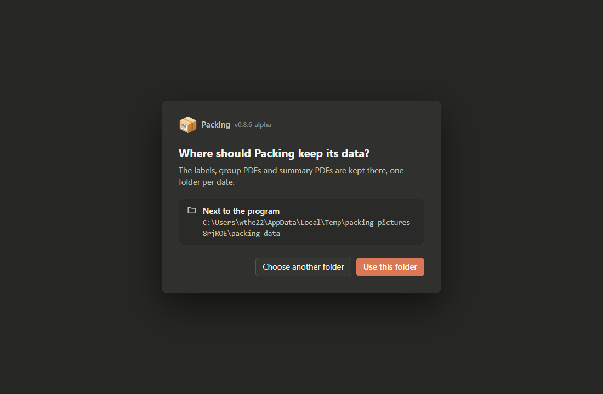

# Setting up the program

The app **Packing** runs on a Windows PC. It takes the *Shipping label + Packing slip* PDFs of one
download from the seller centre, sorts the orders into label groups, and writes one group PDF per group
plus one summary PDF to print. No terminal is needed.

## Set up the program folder

The app is two files, not an installed program.

1. Make a folder `Packing` in a place you can write to, for example `D:\Packing\`, and copy into it
   `Packing.exe` and `pdfium.dll` (the output of `tools/make-portable.sh`, found in `target/portable/`,
   or the files you were given). **Do not** put them under `C:\Program Files` — Windows does not let the app
   write there.
2. The folder must contain `Packing.exe` (the program) and `pdfium.dll` (the PDF reader it uses).
3. Make a shortcut to `Packing.exe` on the Desktop or the taskbar: right-click `Packing.exe` →
   *Show more options* → *Send to* → *Desktop (create shortcut)*. Start the program from the shortcut.

Beside the program the app keeps one file of yours, `packing-app.toml` (where the data is kept, and the
theme). Two more are in the data folder: `parser.toml` (the couriers and how the app tells them apart) and
`config.toml` (the accounts with their shops, and the sort rules). Copying the whole folder to another PC
moves the program and all its data along; pointing a second PC at the same data folder shares the accounts
and the sort rules too.

## The first start

The first time, the app asks **Where should Packing keep its data?**

- **Use this folder** keeps the data in `packing-data` beside the program (*Next to the program*).
  Choose this for a normal setup.
- **Choose a folder** picks another folder, e.g. when the program folder cannot be written.

Nothing more is asked: the Day screen of today opens. An **account** is one shop owner's shops: a name and
the shop names its labels are sent by. The app learns them when labels are first read
([The shop prompt](02-a-day.md#the-shop-prompt)); they can also be made ahead on the **Accounts** screen
([Accounts](03-changes.md#accounts)). The data folder holds one folder per date, for every account.

## Several PCs on one data folder

More than one person can work at the same time: start Packing on each PC with the same data folder
(e.g. a shared network folder chosen with **Choose a folder**, or the same program folder). Each copy
shows what the others save within a few seconds. When two save at the same moment, one waits for the
other; if the other saved some of the same orders, Packing asks to read the labels again.

## A new version of the program

Close the app, then copy the new `Packing.exe` and `pdfium.dll` over the old ones. Your two files and
the `packing-data` folder stay as they are.

A data folder used by version 0.1 (with `labels\`, `state.json`, `categories.toml`) or by version 0.4
(one folder per shop owner) is not read by this version and never deleted: the Day screen says so with
**Open folder**.

### When a new version asks to update the data folder

A new version may keep its files another way, or more of each order, than the one before: from version 0.8
every file of a date sits directly in its date folder, and each order keeps the receiver's province, city
and district and the parcel's weight. Then, before any date opens, it asks **Update the data folder?**: *29 dates
were saved by an older Packing. Updating takes a few minutes and keeps a copy of every file it changes.*

- **Update** moves the files of a date of version 0.7 out of its `input` and `output` folders into the date
  folder, reads the addresses and the weights of the batches saved before from their label PDFs, and writes
  each date's lists again. One line and a bar show how far it is (*Updating 2026-11-24, 3 of 29*), and under
  it the step (*Reading labels: page 3 of 120*). No batch, label or PDF is changed or deleted. When it is done
  the Day screen opens. Each date it changes gets a folder `update v0.8.0-alpha.11` (the version's number): `update.toml` lists every file
  it moved, from where to where, and the folder keeps a copy of each file whose content it changed (the
  journal, `day.toml` or `session.toml`, `orders.csv`, `order-contents.toml`). Those three lists are the
  program's: every save writes them whole, so a column added to `orders.csv` by hand is not kept; edit a
  copy.
- **Open read-only** shows the data as it is and changes nothing in the data folder. The title bar says
  *Read-only*, and what would change something is not shown: **+ New batch**, **Amend**, **Revert**,
  **Print**, the **Printed** tick, **Reprint**, and the changes on the Accounts and Sort rules screens.
  Starting the program again asks again.

A batch whose label PDF in the date folder has changed is not read; when one is skipped, a line says so
(*1 batch not read: 2026-11-24 batch 2, its label PDF has changed.*) and **Continue** opens the Day screen. The
other batches are updated, and the next start asks about it again. The same question comes when another data folder is chosen
that needs it.

If something looks wrong after an Update, close Packing and run
`python tools\update-backup.py revert "<data folder>"` (`--dry-run` first lists what it would do; Python 3.11
or later). It moves every file back, deletes what the Update copied or wrote, and puts back each changed file; the
folder becomes `update v0.8.0-alpha.11 reverted`. A date saved to after the Update is left as it is and named. Once the
dates look right, `python tools\update-backup.py delete "<data folder>"` deletes the update folders (`--dry-run`
first lists them with their sizes). Started with a double-click, the script asks what to do.

A date converted by version 0.8.0-alpha.8 or older keeps its old folders in `v0.7 backup`. Close Packing, then run
`python tools\remove-v07-backup.py "<data folder>"` (`--dry-run` first lists what it would remove). It deletes
a date's `v0.7 backup` only when every file in it is in the date folder, and names what is missing otherwise.
