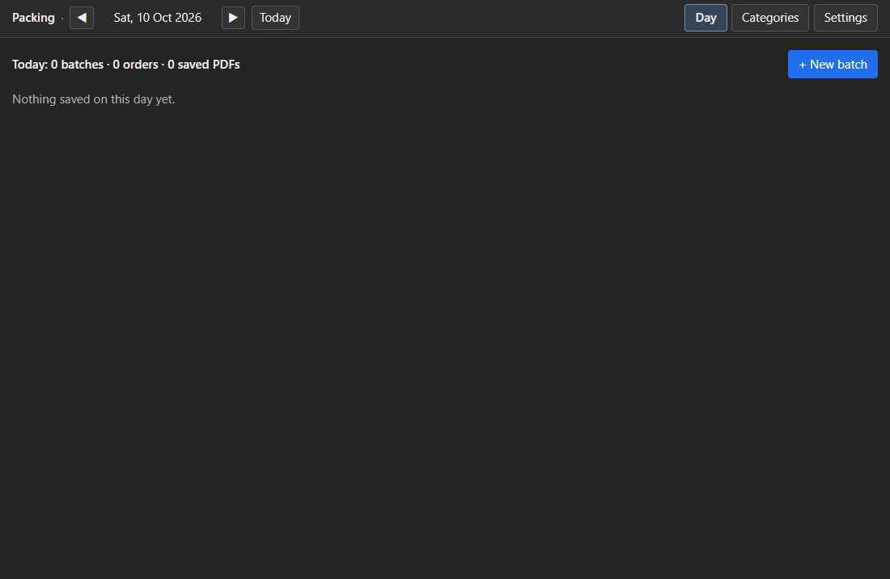
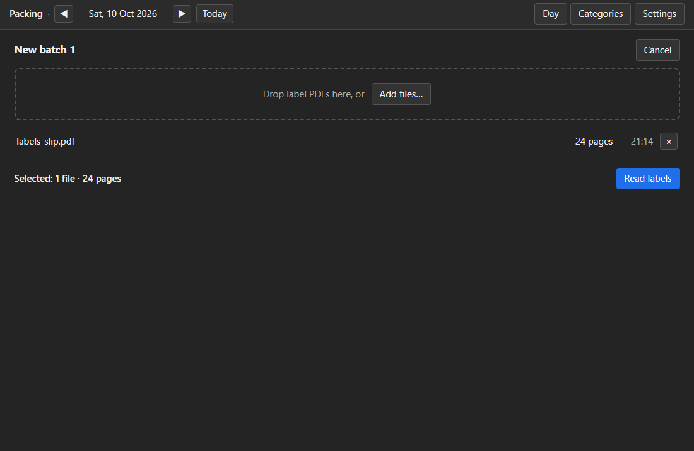
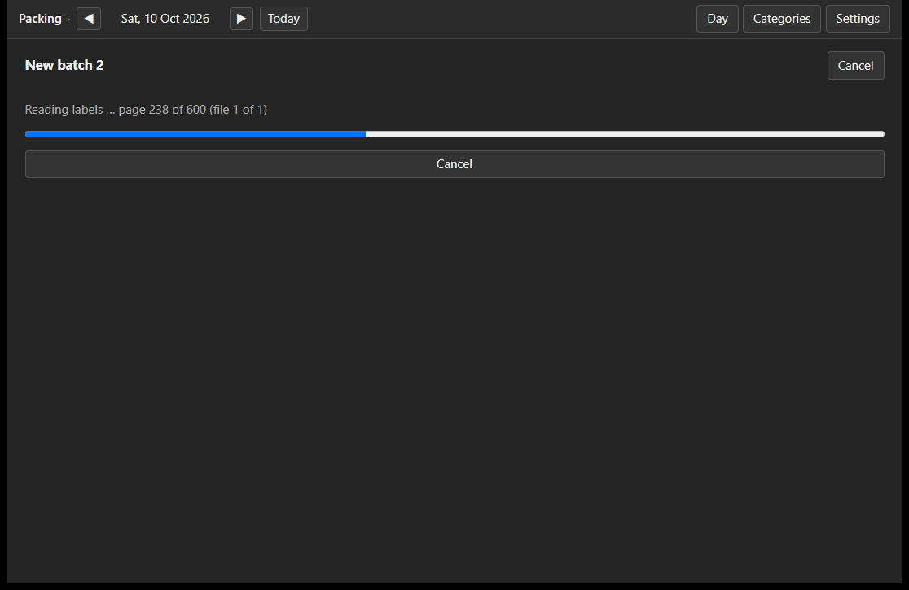
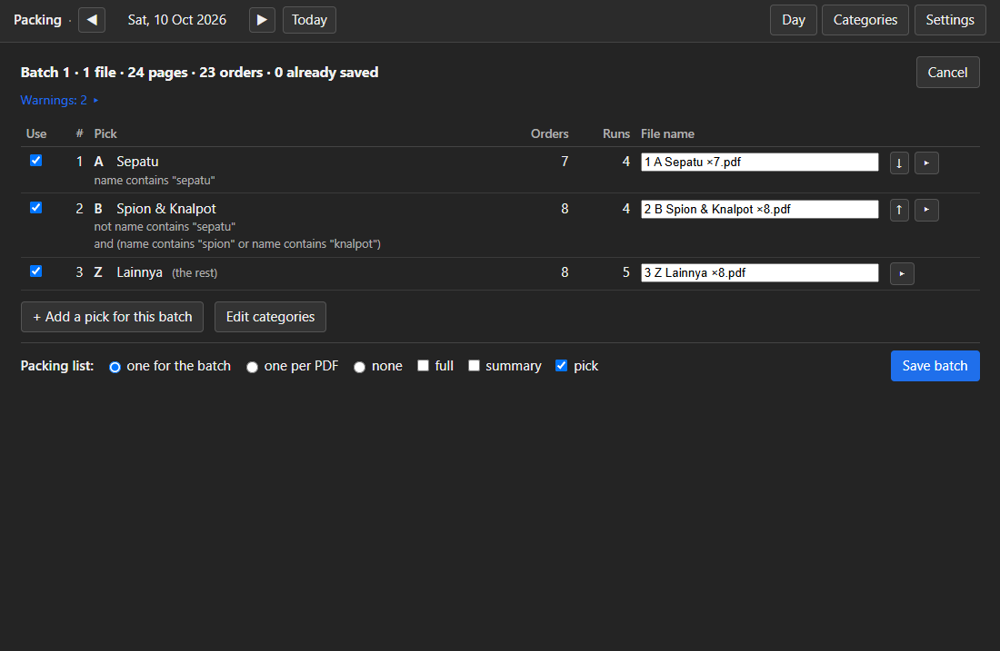
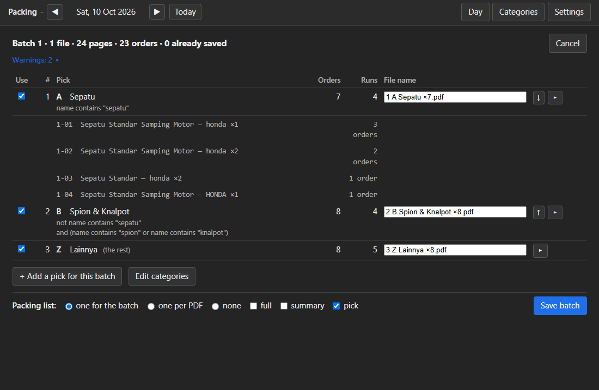
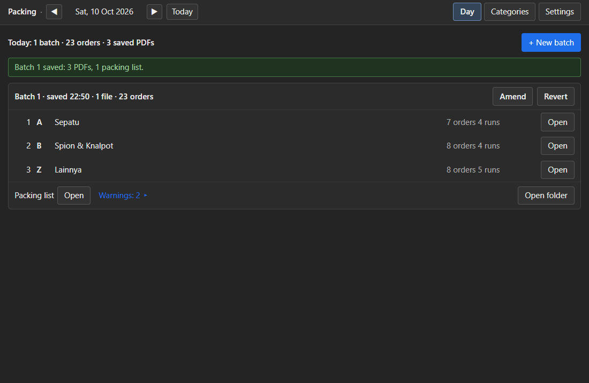

# A day's batches

A batch is one round of the day: you download the labels in the seller centre, prepare them in the
app, then print.

## A normal batch, step by step

### The Day screen

The **Day** screen shows what has been saved today and is the way to the next batch.

- The top line counts today: "Today: 2 batches · 729 orders · 5 saved PDFs".
- **+ New batch** starts a new batch.
- Each batch is a card: "Batch 1 · saved 07:40 · 3 files · 600 orders", with one line per saved
  PDF (number, pick code and name, orders, runs) and **Open** to open it in your PDF viewer.
- **Open folder** opens the batch folder in Explorer.
- On the newest batch only: **Amend** and **Revert**
  ([Revert and amend the last batch](03-changes.md#revert-and-amend-the-last-batch)).
- A day with nothing saved shows "Nothing saved on this day yet."

The date in the top bar is the day everything is saved to. ◀ ▶ step a day; **Today** goes back to
today (handy for a download just after midnight).

### New batch

1. Click **+ New batch**.
2. Add the label files: click **Add files…** and choose the *Shipping label + Packing slip* PDFs
   of this download, or drop them onto the window ("Drop label PDFs here, or Add files…").
   - Each file shows its page count and time. A file already used earlier today shows
     *used in batch n* in orange.
   - **×** removes a file from the list.
3. Click **Read labels**.

### Reading

The app reads the files page by page: "Reading labels …  page 143 of 257 (file 1 of 2)" with a
progress bar. **Cancel** stops and returns to the file list; nothing is written. When it is done
the **Plan** screen opens — after the logo prompt, if the batch has a logo the app has not seen.

### The logo prompt

A courier is named from two clues, and only when they agree: the **logo** printed on the label and
the **tracking-ID form**. The app knows the logos of J&T Express, SiCepat, J&T Cargo, IDX and SPX,
the names of the buttons. A logo the app has not seen before is asked about once, before the
Plan screen, and the answer is kept in `couriers.toml` (of a page's images, the ones drawn in its
top 40 pt are looked at, so the frame, the barcode and the QR never ask):

**Which courier is this logo?** — the logo as printed, with "4 pages · 4 orders" beside it, then a
button per courier name, **Not a courier**, **I don't know** and **Skip all**.

- **A courier name** names those orders at once. An order is named only if its tracking ID fits
  that courier too, so one answer cannot name a wrong courier. The logo is written into
  `couriers.toml`, so later batches know it too.
- **Not a courier** is for an image that is not a courier's logo — a buying channel's strip
  (`tokopedia | TikTok`, `TikTok Shop`, `Shopee`, …). It is written into `couriers.toml` too, so
  the same strip is never asked about again.
- **I don't know** writes nothing: those orders are saved with an empty courier and are listed in
  the day's warning, and the logo is asked about again in the next batch. **Esc** does the same for
  the one logo shown; the next logo still asks.
- **Skip all** stops the prompts for the rest of this batch; nothing is written. The next batch
  asks again from the start.
- The prompt never blocks the work: the batch saves either way.

### Plan

The Plan screen is the heart of the app: which orders go into which saved PDF. It opens with your
categories applied in order.

- The header: "Batch 3 · 2 files · 257 pages · 256 orders · 0 already saved".
- **Rows** are the picks in order. Each takes its orders from the rows above.
- **Use** (the tick) turns a pick off for this batch only; its orders fall to the rows below. The
  rules file is not changed.
- **↑ ↓** move a pick. **▸** shows the runs of a pick — what the packing list will show:

- **File name**: the suggested name is `<n> <code> <name> ×<orders>`; you can change the whole
  name. Two saved PDFs of one batch cannot have the same name (the second shows "Same name as
  PDF 6").
- **+ Add a pick for this batch** adds a one-off pick (it is not saved to your categories).
- **Edit categories** opens your categories
  ([Editing your categories](03-changes.md#editing-your-categories)).
- **Packing list**: choose *one per PDF*, *one for the batch* (default) or *none*, and the layouts
  *full*, *summary*, *pick* (default *pick*).
- **Save batch** writes everything and returns to the Day screen. **Back** (top right) goes back to the
  file list with the files still there; reading again loses the pick changes. Only **Cancel** there
  throws the batch away.

### The check before saving

Before the batch is written, the app reads its own saved PDFs and packing lists back and compares
them with the plan, so a doubled page, a dropped page, an order in two saved PDFs or in none, a
wrong label on a page or a wrong page order is caught before you print. It runs on every save and
takes a second or two; the stage and a progress bar are shown while it writes and then checks
("Writing the saved PDFs …  page 143 of 257", then "Checking the saved PDFs …"), so the window
never looks frozen.

When it finds something, a dialog names it in plain words, the errors and the warnings in two
lists:

- **Save anyway** — the batch is saved anyway. The two lists are kept on the batch card and in the
  batch's `state.json`, so they never scroll away.
- **Cancel — nothing is saved** — the dialog closes and the batch stays on the Plan screen, so you
  can look again, change a pick or save anyway.

A batch with every page in place but in another order is a warning only; it is still saved only
after **Save anyway**.

### After saving

The Day screen shows the new batch on top with a green line "Batch 3 saved: 3 PDFs, 1 packing
list." Click **Open** on each saved PDF and on the packing list, and print them.

A batch saved with **Save anyway** shows "Saved with 2 errors ▸" on its card, beside "Warnings ▸":
click it to read the errors. The two lines stay on the card until the batch is amended or
reverted.

Everything is written into the program folder under `labels\<day>\batch <n>\`: the saved PDFs, the
packing list, a `summary.txt`, and a `download\` copy of the files you read (so Amend works even if
the originals are gone).

## Several batches a day

Do the same for each download. The saved-PDF numbers continue through the day (batch 2 starts
after batch 1's last number), so "sort by name" inside a batch folder is printing order. A file
you read in an earlier batch today is marked *used in batch n*; if you read it again, its orders
are found as already saved and left out (a warning lists them).

## Find a saved order (Search)

**Search** in the top bar opens the Search panel over the screen; **Close** returns. It only reads:
nothing is changed or saved.

- The condition is built with the same boxes as your categories: **field**, **operator** and a
  typed **value**, **+ condition** for a row, **+ group** for a group inside, **not** to reverse one.
- Choose **This day** (the date in the top bar; the default) or **All days**.
- Press **Search**: "3 orders in 2 batches", then one row per order — Order ID, tracking ID,
  courier, items, batch and its saved PDF, with **Open** to print it.
- An order saved before Search existed shows *items not stored*; find it by Order ID or tracking ID.
  Nothing found says "No saved order matches."
