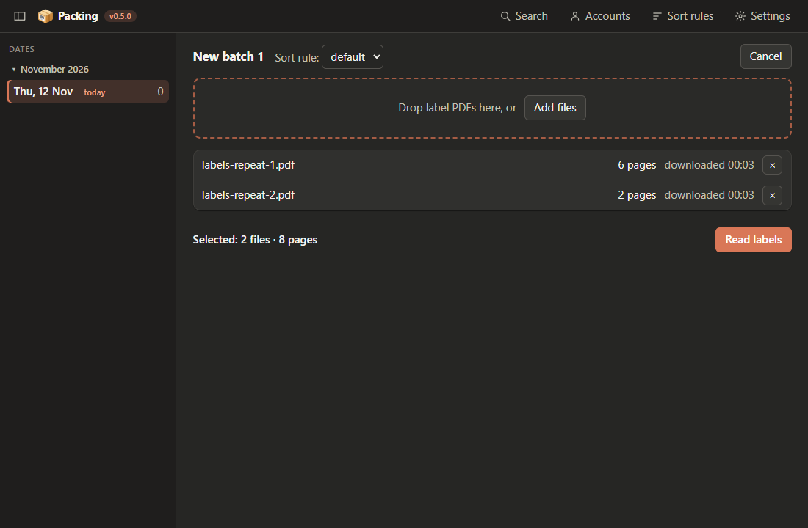
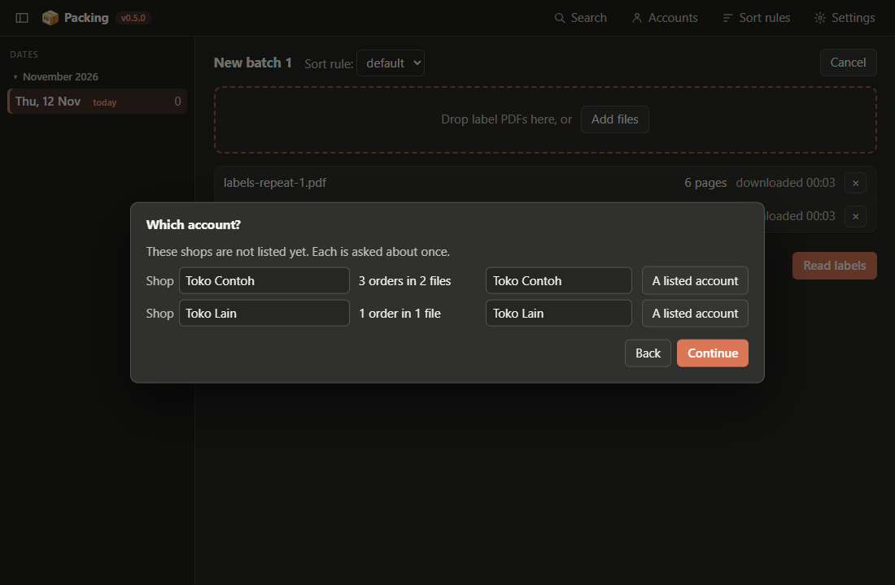
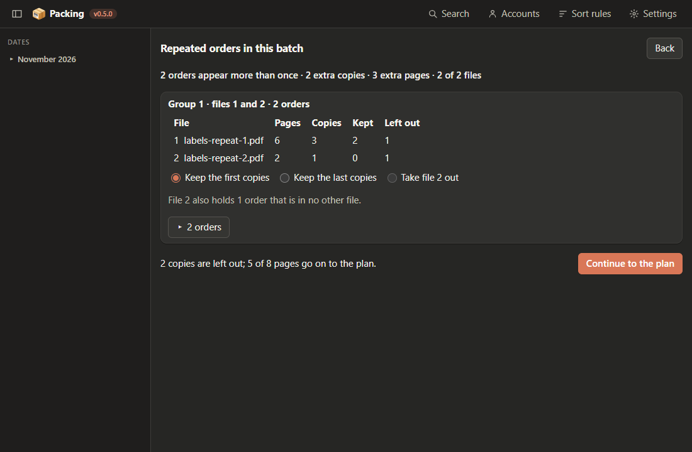
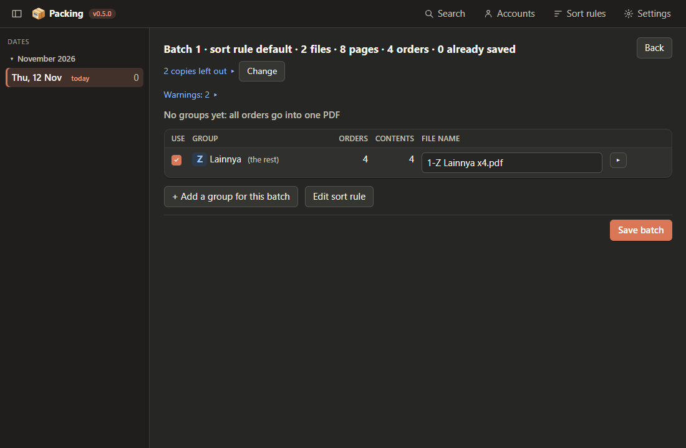

# A day's batches

A batch is one round of the day: you download the labels in the seller centre, prepare them in the
app, then print.

## The window

The title bar has the panel button at the left, the program and its version (**Packing v0.5**), and at
the right **Search** ([finding a saved order](05-search.md)), **Accounts** ([Accounts](03-changes.md#accounts)),
**Sort rules** and **Settings**. `Esc` closes Search, Accounts, Sort rules and Settings.

The **panel** at the left lists the dates of the data folder, for every account together:

- The dates, newest first, by month, each with its number of saved orders of every account. Today is always there,
  marked *today*. Click a date to open it — for a download just after midnight that belongs to the
  evening before. A batch being prepared asks first.
- **⋯** on a date opens its folder in Explorer. A date marked **⚠ damaged** opens for viewing only.
- The panel button in the title bar (or `Ctrl+B`) hides and shows the panel.

## A normal batch, step by step

### The Day screen

The **Day** screen shows what has been saved on the open date and is the way to the next batch.

- The title is the open date, "Wed, 7 Oct 2026" (with *today* when it is), and its counts beside it:
  "2 batches", "729 orders", "5 group PDFs".
- **+ New batch** starts a new batch.
- **Day summary** writes one PDF of the whole date and opens it: each batch as its card shows it; the
  orders per courier (the count to hand over at each pickup); each batch's label files with their pages;
  the pick list of the whole day; last, every order content of the day with its orders, the most orders
  first. It is written again each time you press it, so press it after the last batch of the day. When the
  date holds more than one account it is a menu: **All accounts**, then each account for that account's
  orders alone. A day summary still open in a PDF viewer may have to be closed first.
- Each batch is a card: "Batch 2", "saved 09:12 · 2 files · 129 orders · Toko Alfa 88, Toko Beta 41" (the
  accounts of the batch, the one with most orders first), one line per group PDF (`2-A`, its name,
  "88 orders", "3 contents") with **Print** and **Open**, and a line for the batch's summary PDF with
  **Open** (a summary PDF is opened and printed from the PDF viewer, so it has no **Print**). A batch
  with several accounts has one more button per account on that line: **Toko Alfa** writes the summary of
  that account's orders in the batch and opens it.
- **Reprints**, under the batches, lists each reprint made on the date: `R1`, when it was made, its
  orders and pages, **Open**, and **Orders ▸** for the orders in it.
- The tick beside **Open** notes that you have printed that group PDF. It is only a note — nothing is
  blocked — and it is saved the moment you click it. A batch you amend starts with its ticks cleared.
- **Open folder** opens the date's `output` folder in Explorer.
- On the newest batch only: **Amend** and **Revert** ([Changes](03-changes.md)).
- A date with nothing saved shows "Nothing saved on this date yet."

### New batch

1. Click **+ New batch**.
2. **Sort rule** is already set to the rule you used last, also on a new day; change it only for a batch
   that is sorted another way ([Sort rules](03-changes.md#sort-rules)). Only the rules that are on are
   listed.
3. Add the label files: **Add files** and choose the *Shipping label + Packing slip* PDFs of this
   download, or drop them onto the window. Add the files of every shop at once: the account of each order
   is found from the shop name printed on its label.
   - Each file shows its page count and time. A file read in an earlier batch of this date shows
     *used in batch n* in orange: its orders are found as already saved.
   - **×** takes a file off the list.
4. Click **Read labels**. "Reading labels …  page 143 of 257 (file 1 of 2)" with a progress bar;
   **Cancel** stops and writes nothing.

### The logo prompt

A courier is named from two clues, and only when they agree: the **logo** on the label and the form of
its **tracking ID**. A logo the app has not seen is asked about once, before the plan:
**Which courier is this logo?**, the logo as printed and "4 pages · 4 orders", then a button per
courier, **Not a courier**, **I don't know** and **Skip all**.

- **A courier name** names those orders and is remembered in `packing-workflows.toml`, beside the
  program.
- **Not a courier** is for a buying channel's strip (`TikTok Shop`, `Shopee`, …); it is remembered too.
  The known strips are already in the file. An instant (same-day) label is named by its tag (`GKS`
  Gojek, `Sameday` Grab), so its strip is never asked about.
- **I don't know** (or **Esc**) writes nothing: the orders save without a courier and the logo is asked
  about again next batch. **Skip all** does that for the rest of the batch.

### The shop prompt

An order belongs to the account that lists the shop name on its label. A shop name no account lists is
asked about once, after the logo prompt and before the plan: **Which account?**, "These shops are not
listed yet.", and one row per shop name read.

- A row shows the **Shop** name as read, how many orders in how many files carry it, and its account:
  choose one from the list, or press **New account** to make an account named after the shop. The new
  name is a field, put right in place (as in the picture); **A listed account** returns to the list. The
  shop name is a field too, so a name read with a stray space can be put right; it must stay a name found
  on those labels.
- Labels that show no shop name are listed by file ("2 of 85 orders") with an account for this read only.
- **Continue** is off until every row has an account, then remembers every answered shop in
  `packing-settings.toml`: it is never asked again. **Back** (or `Esc`) returns to the file list and
  remembers nothing.

### Repeated orders

When an order is in the files more than once — two downloads that overlap, or a label printed twice —
**Repeated orders** opens before the plan: "14 orders appear more than once · 14 extra copies · …".

- One card per group of files that repeat each other, with each file's copies kept and left out.
- **Keep the first copies** is chosen already; **Keep the last copies** and **Take file 3 out** are the
  other choices. A file that also holds orders of its own cannot be taken out, and the card says so.
- **▸ 10 orders** lists the repeated orders, *same* or *differs: the tracking ID*, with one choice per
  copy; a choice there overrides the card for that order (*Chosen by hand*).
- **Continue to the plan** keeps exactly one copy of each order. **Back** returns to the file list,
  where each file with a repeat shows its group (▌G1) and **Review the repeats**.

### Plan

Which orders go into which group PDF. It opens with the sort rule applied in order; on a normal day you
check the counts and press **Save batch**.

- The header: "Batch 3 · sort rule default · 2 files · 257 pages · 256 orders · 0 already saved". When
  copies were left out: "14 copies left out ▸" lists them, **Change** returns to Repeated orders.
- **Rows** are the groups of the sort rule, in order; each takes its orders from what the rows above
  left. **Use** unticked skips a group for this batch only. **↑ ↓** move a group for this batch.
- **▸** lists a group's order contents: "Sepatu Standar ×1 · 96 orders".
- **File name** is suggested as `3-A Sepatu x130`; you can change it. Two group PDFs of a batch cannot
  share a name.
- **+ Add a group for this batch** adds a one-off group. **Edit sort rule** opens the
  [Sort rules](03-changes.md#sort-rules) screen on this batch's rule; a save there rebuilds the plan.
- When the sort rule has no groups yet: **No groups yet: all orders go into one PDF**.
- **Back** returns to the file list with the files still there; only **Cancel** there throws the batch
  away.

Next: [Saving, printing and several batches](02b-saving.md).
