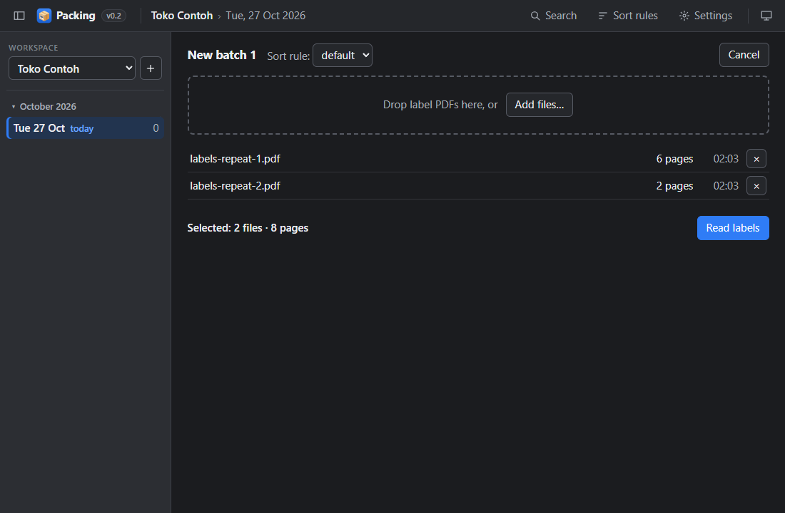
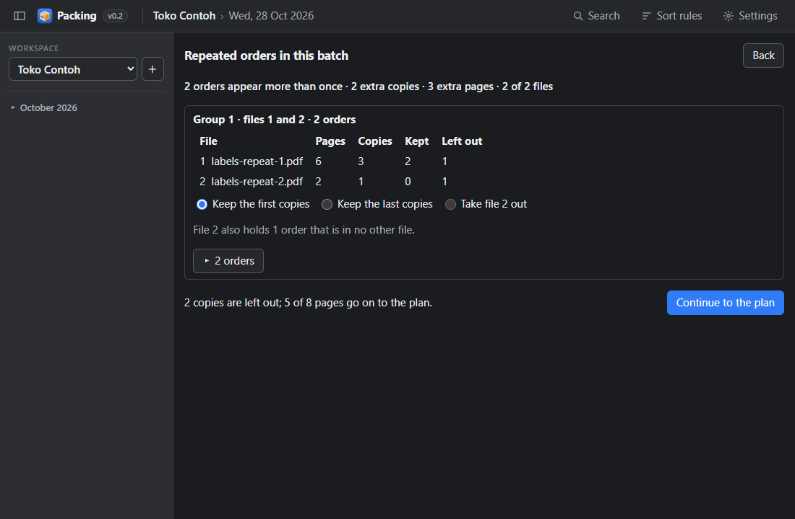
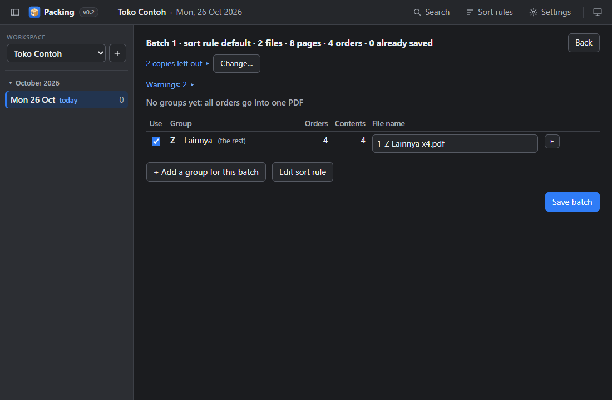
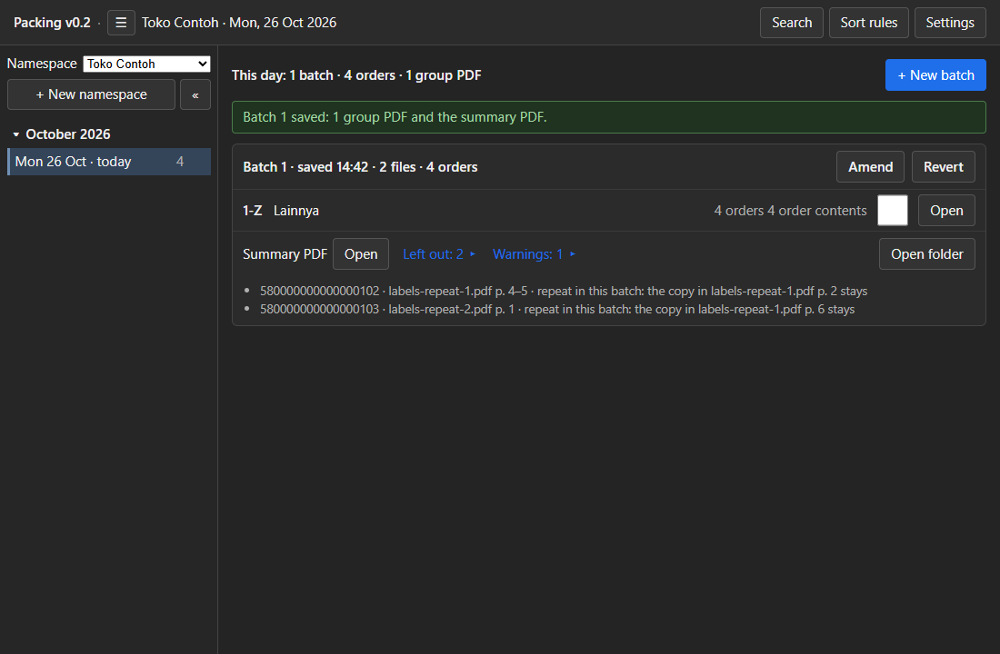
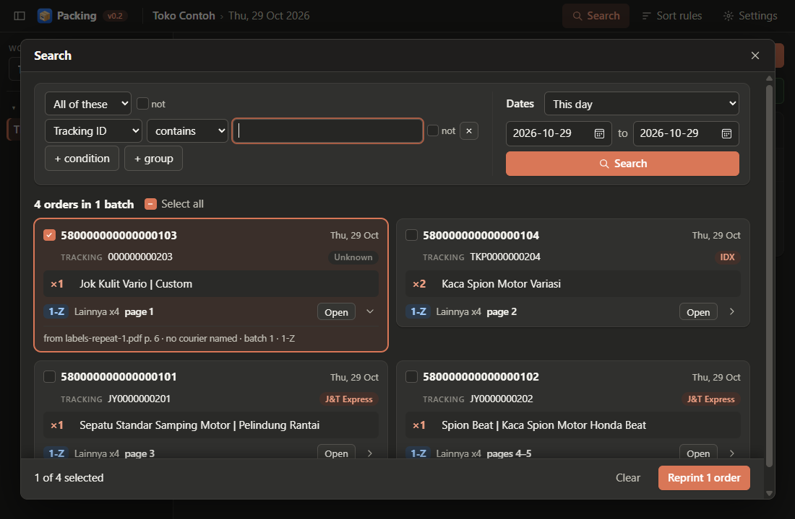

# A day's batches

A batch is one round of the day: you download the labels in the seller centre, prepare them in the
app, then print.

## The window

The title bar has the panel button at the left, the program and its version (**Packing v0.2**), the open
namespace and the date everything is saved to, and at the right **Search**, **Sort rules**, **Settings** and
the theme menu (**Light**, **Dark** or **System**, which follows Windows). `Esc` closes Search, Sort rules
and Settings.

The **panel** at the left lists your namespaces and the dates of the open one:

- **Namespace** chooses another namespace; **+** beside it asks for a new name and opens it on today.
- The dates, newest first, by month, each with its number of saved orders. Today is always there,
  marked *today*. Click a date to open it — for a download just after midnight that belongs to the
  evening before. A batch being prepared asks first.
- **⋯** on a date opens its folder in Explorer. A date marked **⚠ damaged** opens for viewing only.
- The panel button in the title bar (or `Ctrl+B`) hides and shows the panel.

## A normal batch, step by step

### The Day screen

The **Day** screen shows what has been saved on the open date and is the way to the next batch.

- The top line counts the date: "This day: 2 batches · 729 orders · 5 group PDFs".
- **+ New batch** starts a new batch.
- Each batch is a card: "Batch 2 · saved 09:12 · 2 files · 129 orders", one line per group PDF
  (`2-A`, its name, orders, order contents) with **Open**, and a line for the batch's summary PDF.
- The tick beside **Open** notes that you have printed that group PDF. It is only a note — nothing is
  blocked — and it is saved the moment you click it. A batch you amend starts with its ticks cleared.
- **Open folder** opens the date's `output` folder in Explorer.
- On the newest batch only: **Amend** and **Revert** ([Changes](03-changes.md)).
- A date with nothing saved shows "Nothing saved on this day yet."

### New batch

1. Click **+ New batch**.
2. **Sort rule** is already set to the rule of your newest batch; change it only for a batch that is
   sorted another way ([Sort rules](03-changes.md#sort-rules)).
3. Add the label files: **Add files…** and choose the *Shipping label + Packing slip* PDFs of this
   download, or drop them onto the window.
   - Each file shows its page count and time. A file read in an earlier batch of this date shows
     *used in batch n* in orange: its orders are found as already saved.
   - **×** takes a file off the list.
4. Click **Read labels**. "Reading labels …  page 143 of 257 (file 1 of 2)" with a progress bar;
   **Cancel** stops and writes nothing.

### The logo prompt

A courier is named from two clues, and only when they agree: the **logo** on the label and the form of
its **tracking ID**. A logo the app has not seen is asked about once, before the plan:
**Which courier is this logo?**, the logo as printed and "4 pages · 4 orders", then a button per
courier, **Not a courier**, **I don't know** and **Skip all**.

- **A courier name** names those orders and is remembered in `packing-workflows.toml`, beside the
  program.
- **Not a courier** is for a buying channel's strip (`TikTok Shop`, `Shopee`, …); it is remembered too.
- **I don't know** (or **Esc**) writes nothing: the orders save without a courier and the logo is asked
  about again next batch. **Skip all** does that for the rest of the batch.

### Repeated orders

When an order is in the files more than once — two downloads that overlap, or a label printed twice —
**Repeated orders** opens before the plan: "14 orders appear more than once · 14 extra copies · …".

- One card per group of files that repeat each other, with each file's copies kept and left out.
- **Keep the first copies** is chosen already; **Keep the last copies** and **Take file 3 out** are the
  other choices. A file that also holds orders of its own cannot be taken out, and the card says so.
- **▸ 10 orders** lists the repeated orders, *same* or *differs: the tracking ID*, with one choice per
  copy; a choice there overrides the card for that order (*Chosen by hand*).
- **Continue to the plan** keeps exactly one copy of each order. **Back** returns to the file list,
  where each file with a repeat shows its group (▌G1) and **Review the repeats**.

### Plan

Which orders go into which group PDF. It opens with the sort rule applied in order; on a normal day you
check the counts and press **Save batch**.

- The header: "Batch 3 · sort rule default · 2 files · 257 pages · 256 orders · 0 already saved". When
  copies were left out: "14 copies left out ▸" lists them, **Change…** returns to Repeated orders.
- **Rows** are the groups of the sort rule, in order; each takes its orders from what the rows above
  left. **Use** unticked skips a group for this batch only. **↑ ↓** move a group for this batch.
- **▸** lists a group's order contents: "Sepatu Standar ×1 · 96 orders".
- **File name** is suggested as `3-A Sepatu x130`; you can change it. Two group PDFs of a batch cannot
  share a name.
- **+ Add a group for this batch** adds a one-off group. **Edit sort rule** opens the
  [Sort rules](03-changes.md#sort-rules) screen on this batch's rule; a save there rebuilds the plan.
- When the sort rule has no groups yet: **No groups yet: all orders go into one PDF**.
- **Back** returns to the file list with the files still there; only **Cancel** there throws the batch
  away.

### Saving and the check

**Save batch** copies the label files into the date's `input` folder, writes the group PDFs and the
summary PDF, and then a separate checker reads every written page back and compares it with the
source pages and the plan: a doubled, missing, swapped or foreign page is caught before you print.
The stage and a progress bar show while it runs (*Copying inputs*, *Writing*, *Verifying*, *Saving*).

When the checker finds something, a dialog lists the errors and the warnings apart:

- **Save anyway** saves the batch; its card then shows "Saved with 2 errors ▸" until it is amended or
  reverted.
- **Cancel — nothing is saved** keeps the batch on the Plan screen.

### After saving

The new batch is on top with a green line "Batch 3 saved: 3 group PDFs and the summary PDF." **Open**
each group PDF and the summary PDF and print them.

- **Left out: 3 ▸** on a card lists each copy left out and why: a repeat (and the copy that stays) or
  an order saved earlier in another batch.
- **⚠ missing** or **⚠ changed** in place of **Open** means the file in `output` is gone or not as
  saved; **Restore** writes it again from the stored labels and checks it like the original.

## Several batches a day

Do the same for each download; the batches of a date are numbered 1, 2, 3. An order saved in a batch of
the date is left out of every later batch of that date, so reading a file again saves nothing twice.

## Find and reprint a saved order (Search)

**Search** opens over the screen; **Close** returns. Searching changes nothing.

- Build the filter with the same boxes as the sort rules, e.g. *Tracking ID starts with JY00000012*.
- **This day** (the open date, the default) or **All days** of the namespace, then **Search**:
  "3 orders in 2 batches" and one row per order — Order ID, tracking ID, courier, items, date and group,
  **Open** for its group PDF, and **▸** for where it came from (the label file and pages, and the clue
  that named its courier).
- Tick the orders to print again (or **Select all results**) and press **Reprint 2 orders**: one PDF of
  their label pages, in their original printing order, checked like a save, written into today:
  "Reprint 1 written: 2 orders, 2 pages." with **Open**. The orders stay in their batches; today's Day
  screen lists it under **Reprints**.
