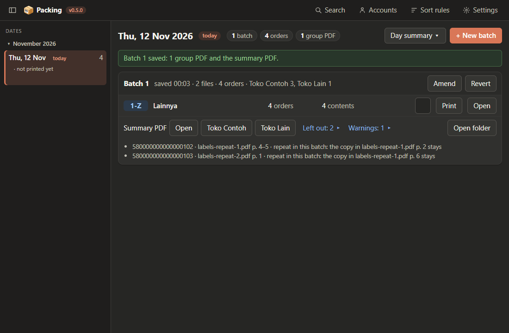

# Saving, printing and several batches

Continues [A day's batches](02-a-day.md#a-normal-batch-step-by-step).

## Saving and the check

**Save batch** copies the label files into the date's `input` folder, writes the group PDFs and the
summary PDF, and then a separate checker reads every written page back and compares it with the
source pages and the plan: a doubled, missing, swapped or foreign page is caught before you print.
The stage and a progress bar show while it runs (*Copying inputs*, *Writing*, *Verifying*, *Saving*).

When the checker finds something, a dialog lists the errors and the warnings apart:

- **Save anyway** saves the batch; its card then shows "Saved with 2 errors ▸" until it is amended or
  reverted.
- **Cancel — nothing is saved** keeps the batch on the Plan screen.

## After saving

The new batch is on top with a green line "Batch 3 saved: 3 group PDFs and the summary PDF." **Print** or
**Open** each group PDF, and **Open** the summary PDF, and print them. The summary PDF's first page lists
the orders per courier by name, the accounts of the batch with their orders and units, the warnings, the
label files read and the sort rule; then each group's order contents, numbered `A-1`, `A-2`, … in the
order the group PDF prints them; then what to take from stock.

- **Left out: 3 ▸** on a card lists each copy left out and why: a repeat (and the copy that stays) or
  an order saved earlier in another batch.
- **Open** on a file that is gone from `output` writes it again from the stored labels, checks it like
  the original, then opens it. To see an old batch's summary PDF in the current layout, delete it in
  Explorer and press **Open**. **⚠ missing** before **Open** says the file was gone when the date opened;
  **⚠ changed** with **Restore** says it is not as saved, and **Restore** writes it again.

## Several batches a day

Do the same for each download; the batches of a date are numbered 1, 2, 3, one count for every account together. An order saved in a batch of
the date is left out of every later batch of that date, so reading a file again saves nothing twice.
