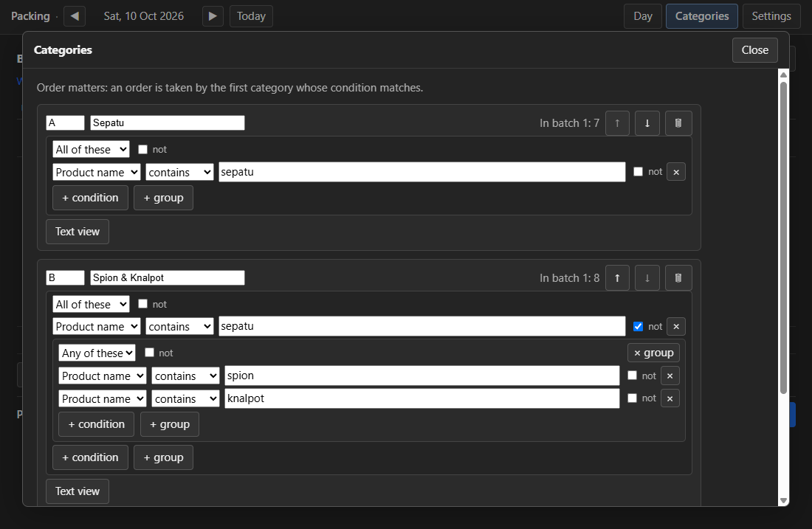

# Changing the last batch or the categories

## Revert and amend the last batch

Only the newest batch can be changed — later batches depend on it.

- **Revert** — undo the last batch. It asks:
  "Undo batch 2? Its 2 saved PDFs, packing list and download copies are deleted, and its 129
  orders can be saved again. If you already printed them, throw the printed labels away."
  [Cancel] [Undo batch 2]. The orders count as not saved again and the next batch reuses the
  numbers. If a file is open in a PDF viewer, the app says which file to close and changes
  nothing.
- **Amend** — "I fixed a category, do the last batch again". It asks:
  "Redo batch 2 with the current categories? Batch 2 was saved at 09:12. If you already printed
  it, print it again after saving." [Cancel] [Redo batch 2]. The Plan screen opens again (titled
  *Redo batch 2*, button *Save batch 2 again*); **Save** writes the batch again over the old one,
  **Cancel** leaves it unchanged.

## Editing your categories

Open **Categories** (in the top bar, or **Edit categories** on the Plan screen). Categories are
your picks, in order: an order is taken by the first category whose condition matches. The last
category has no condition and takes the rest.

- Each category has a **code**, a **name** and a condition. The condition is built from boxes: a
  group is **All of these** (*and*) or **Any of these** (*or*) and holds rows of
  *field · operator · value*; **not** reverses a row or a group.
- **Text view** switches one category to typing the condition as text; **Boxes** switches back.
  **Edit file as text** shows the whole file. **Help: examples ▸** lists examples.
- **Save** writes the file; **Cancel** leaves it unchanged. Your comments are kept.

Four example conditions (more in [the rules file](../software-design/rules-file/README.md)):

| You want | Condition |
|---|---|
| everything with "sepatu" in the product name | `name contains "sepatu"` |
| orders of 3 items or more | `total_quantity >= 3` |
| everything sent by J&T | `courier starts_with "J&T"` |
| spion or knalpot, but not sepatu | `not name contains "sepatu" and (name contains "spion" or name contains "knalpot")` |
