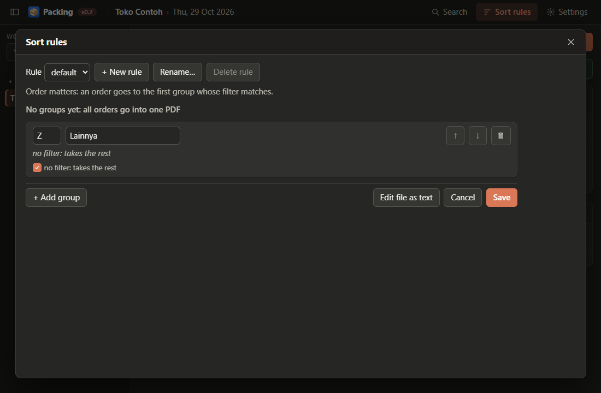

# Changing the last batch or the sort rules

## Revert and amend the last batch

Only the newest batch of a date can be changed — a later batch depends on the ones before it.

- **Revert** — undo the last batch. It asks: "Undo batch 2? Its 2 group PDFs and summary PDF are
  deleted. Throw away its printed labels." [Undo batch 2] [Cancel]. Its orders count as not saved
  again and the next batch takes its number. If a file is open in a PDF
  viewer, the app names the file to close and changes nothing.
- **Amend** — "I fixed a sort rule, do the last batch again". It asks: "Redo batch 2? Its labels
  are read again with the sort rule default." [Redo batch 2] [Cancel]. The batch's own label files are
  read again from the date's `input` folder, with the sort rule of that name as it is now (or as it was
  saved, when no rule has that name any more), the same copies of repeated orders kept, and the **Plan**
  screen opens titled *Redo batch 2*; **Save batch** writes it again. Print it again after saving.
  - **Back** (top) shows the batch's files, its rule fixed ("Sort rule: default (as now)"); add files
    with **Add files…**, take one off with **×** (its orders stay unsaved for a later batch), then
    **Read labels** again.
  - **Cancel amend** or **Cancel** on the file list leaves the batch as it was, and asks nothing.
  - The batch written again starts with its printed ticks cleared.

## Sort rules

**Sort rules** in the title bar, or **Edit sort rule** on the Plan screen, opens the sort rules of
`packing-workflows.toml`, the file beside the program. A sort rule is a list of label groups in order: an
order goes to the first group whose filter matches; the last group has no filter and takes the rest.

- **Rule** chooses the rule shown (from the Plan screen: the batch's rule). **+ New rule** asks for a
  name and starts with one group *Z Lainnya*, or as *a copy of* the rule shown. **Rename…** changes the
  name; saved batches keep the name they were saved with. **Delete rule** asks first; the last rule
  stays.
- Each group has a **code** (1–3 letters or digits), a **name** and a filter made of boxes: a box is
  **All of these** (*and*) or **Any of these** (*or*) and holds rows of *field · operator · value* and
  boxes inside; **not** reverses a row or a box. The Courier row lists the couriers by name.
- **Courier · is unknown** takes the orders whose courier the app could not name, and **Tracking ID · is
  unknown** those without a tracking ID (instant-service labels); with **not**, the others. *Is empty* does
  the same on the other text fields.
- **In batch 3** is the count each group takes in the batch being prepared, so a change can be judged
  before saving.
- **Text view** types one group's filter as text; **Boxes** switches back. **Edit file as text** shows
  the whole file, comments included. **Help: examples ▸** lists examples.
- **Save** writes the file, keeping your comments and every filter you did not change; the batch being
  prepared follows the new rule, and its skips and file names stay where they still apply.

Four example filters (more in [the rules file](../software-design/rules-file/conditions.md)):

| You want | Filter |
|---|---|
| everything with "sepatu" in the product name | `name contains "sepatu"` |
| orders of 3 items or more | `total_quantity >= 3` |
| everything sent by J&T Express | `courier equals "jnt"` |
| spion or knalpot, but not sepatu | `not name contains "sepatu" and (name contains "spion" or name contains "knalpot")` |
