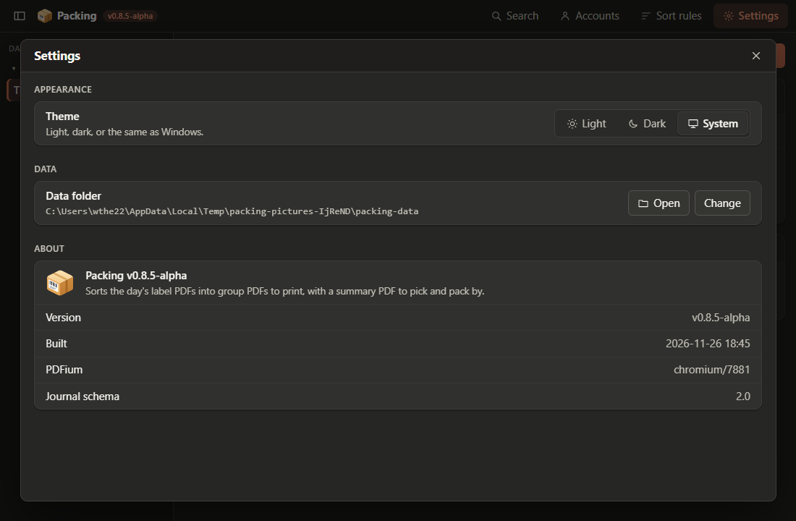

# Messages and settings

## The messages you will meet

A **stop** ends the step and writes nothing. A **warning** is listed under **Warnings ▸**; the batch
can still be saved. The full list is in [the screens' messages](../software-design/ui/messages.md).

| Message | What to do |
|---|---|
| **These labels have no packing slip.** | You downloaded plain labels. In the seller centre, download again with **Shipping label + Packing slip**. |
| **Page `
` of `<file>` has no Order ID.** | The file does not look like a label download. Take it off the list and use the right file. |
| **`<file>` cannot be read as a PDF.** | It may be damaged or still downloading: download it again. |
| **All `<n>` orders were already saved today** | These labels were done in an earlier batch of this date. Nothing to do. |
| **`<n>` orders were already saved today** and are left out | A warning: those orders are skipped. Take the file off the list if you did not mean to read it again. |
| **`<n>` orders are in the files more than once** | A warning: one copy of each order is kept ([Repeated orders](02-a-day.md#repeated-orders)). |
| **Courier unknown** for some orders | A warning: they are sorted normally; only a filter on the courier cannot see them. |
| **Slip total differs** | A warning: check that order's packing slip when you pack it. |
| **`<file>` is open in another program.** | Close the PDF viewer, then press the button again. |
| **A rules file has an error:** `<file, line, col: message>` | Fix that file (`parser.toml` or `config.toml`) in the data folder, or the rule in **Sort rules**. |
| **Another copy of the app is still writing to the data folder** | Another PC is saving a big batch: try again in a moment. |
| **Another copy of the app saved or reverted a batch of this date after these labels were read** | Someone else saved some of the same orders: read the labels again. |
| **This folder also holds data of Packing v0.1** | The data of the old version stays where it is and is not read. |

When the checker finds something while saving, a dialog lists the errors and the warnings apart, with
**Save anyway** and **Cancel — nothing is saved** ([Saving and the check](02b-saving.md#saving-and-the-check)).
A reprint or a restore that the checker refuses keeps nothing and says why.

## Settings

Open **Settings** in the title bar. Each row is a setting at the left and its control at the right.

- **Theme** — **Light**, **Dark** or **System** (follows Windows).
- **Data folder** — where the dates of every account are kept (the default is `packing-data` beside
  the program). **Change** asks "Use `<folder>` for the data from now on? The data in `<old>` stays where
  it is." and opens that folder; nothing is moved. **Open** shows it in Explorer.
- **Kept, not read** — shown only when `packing-app.toml`, `parser.toml` or `config.toml` holds a key this
  version does not know (a typing slip such as `enabeld`, say): the file, the line and the key. The key stays
  in the file and does nothing; fix or delete it in the file if it was a slip.
- **Archive dates older than** a number of days (60 to begin with) and **Off** / **On**. When on, those
  dates are archived at each start, after the question to update the data folder. Turning it on, or a lower
  number, asks first when it would archive a date at once ([Archiving old dates](#archiving-old-dates)).
- The accounts and their shops are on the **Accounts** screen ([Accounts](03-changes.md#accounts)), not here.
- **About** — what the program does, its version (**v0.8.0-beta.1**), the time it was built, the PDFium version
  and the journal's schema version.

There are no other settings but the Archive page's: the sort rule you used last is preselected, the summary PDF is
always written, and the couriers live in `parser.toml` and the sort rules in `config.toml`, both in the data folder.

The app is in English. Every screen text is in one file, so another language can be added.

## Archiving old dates

An old date needs its orders and summaries, not its PDFs. Archiving a date deletes every PDF of it: the label
downloads, the group PDFs, the summary PDFs, the reprints and the summaries made on request. It is done on the
Archive page: **Archive** beside *Dates* at the top of the panel. `Esc` closes it. Archiving on its own is a setting (above).

- **Dates** — every date, newest first, by month, with its orders and its size; the data folder's size
  stands at the right (*3.2 GB in all*), and an archived date says *Archived*. A date that can be archived has
  a tick: **Shift**+click ticks every date between the last tick and this one, and a month's tick ticks or
  clears its dates.
- The foot names the dates ticked and the size of their PDFs (*1 date · 72.3 MB of PDFs*). **Archive** asks
  first: *Archive 3 dates? Their PDFs (210 MB) are deleted; their orders and summaries stay.*
- In read-only mode the page shows the dates and sizes only.

- What stays: the date's orders, its order contents and the record of each batch. The Day screen still shows
  the batches with their groups, counts, Sent times, Printed ticks, warnings and **Left out**; **Day summary**
  and an account's summary still work; Search still finds the orders.
- What goes: the date can no longer be printed, amended, reverted, reprinted or read again. The Day screen
  says *Archived: the PDFs of this date were removed.* and shows no **Print**, **Open**, **Restore**,
  **Amend**, **Revert** or **+ New batch**; in Search its orders say *archived* and take no tick.
- Today is never archived, and neither is a date with nothing saved.
- A PDF open in a viewer cannot be deleted: it is named and stays. The label downloads go last, so such a
  date is not archived yet; close the viewer and archive it again.
- More than one date shows its progress: *Archiving: 2026-10-07, 2 of 3*.
