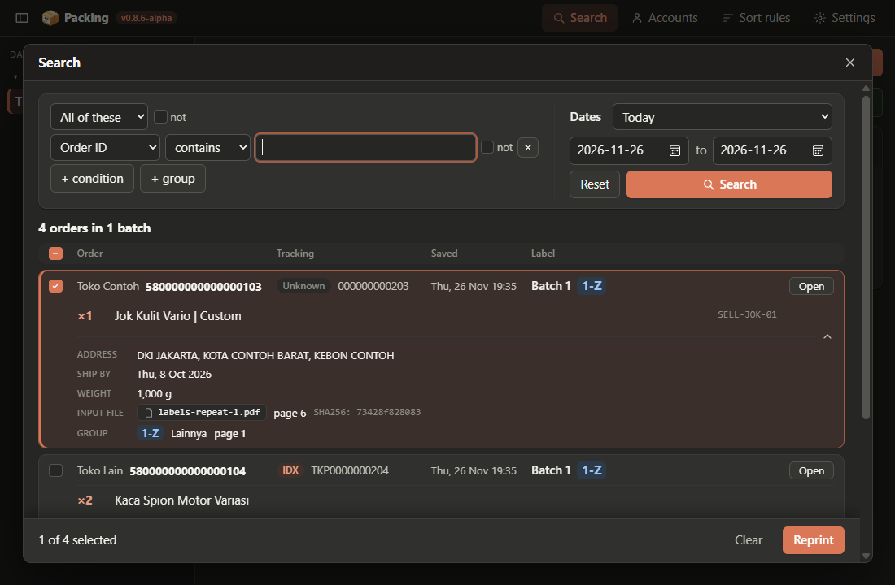
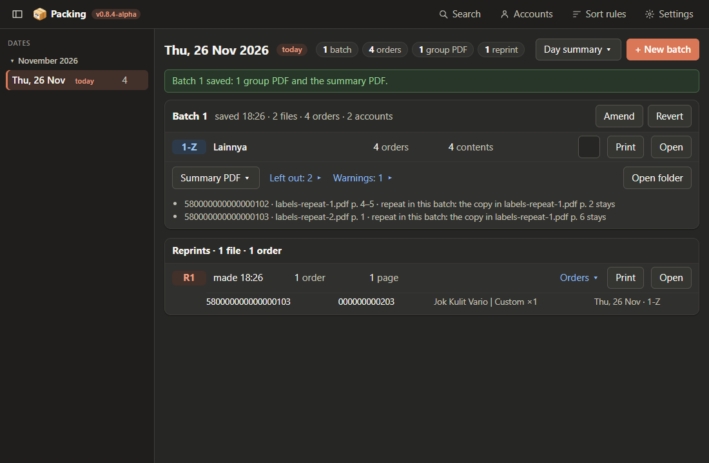

# Find and reprint a saved order (Search)

**Search** opens over the screen; **Close** returns. Searching changes nothing.

- Build the filter with the same boxes as the sort rules. The first box is *Order ID contains*, so a
  part of an ID is enough, e.g. *Order ID contains 00000012*.
  The first box has the cursor when Search opens, and **Enter** searches: scan an Order ID barcode and
  its order is found at once. For a tracking ID, switch the box to *Tracking ID* first.
  Search opens again with the boxes as they were left, until the program is closed; **Reset** empties them
  and sets the dates back to the viewed day.
- **Dates**: **Viewed day** (the date the Day screen shows, the default; not listed when that is today),
  **Today**, **Yesterday**, **Last 7 days**, **Last 30 days**, **Custom range** (pick the first and last
  date) or **All days**, of every account, then **Search**: "3 orders in 2 batches" and one card per order.
- Each card's first row is under the heads **Order**, **Tracking**, **Saved** and **Label**: the shop (the
  account's name when the label printed none) and the Order ID; the courier and the tracking ID; the date
  and time the batch was saved; the batch and the group's code, and, in a wide enough window, the group's
  name and the **page** the label is on in the group PDF (to find the printed label in its stack).
  **Open** opens that group PDF. Under it the items, one line each: the quantity, the name, the variation
  and the Seller SKU; the slip's Qty Total under them when there are several lines.
- A click on a card (or on the arrow under its items) opens the rest; another click closes it. The rest:
  the receiver's address, the ship-by date, the parcel's weight, the label file it was read from with its
  page and hash (*SHA256: …*), and, when the window had no room for them in the first row, the group's
  name and page. The pickup code and the account show there only when the card does not show them
  already.
- **Account** and **Shop**: *Account equals* picks one account from the list and narrows the search to its
  orders; *Shop* does the same for a shop name. Without them every account is searched.
- **Courier**: *equals* picks one courier from the list; *contains* or *starts with* takes typed text, so
  `J&T` finds J&T Express and J&T Cargo.
- An order printed again before carries **Reprinted** beside **Open**; point at it to see which reprint and when.
- Tick the orders to print again with their ticks; the tick in the heads' row (**Select all**) ticks every
  order or none. A search that finds one order ticks it. A double click or a drag on a card selects text to
  copy (an Order ID, a tracking ID) and leaves the card as it was.
- The bar at the foot says how many are selected and has **Reprint**: one PDF of their label
  pages, in their original printing order, checked like a save, written into today: "Reprint 1 written:
  2 orders, 2 pages." with **Open**. When one of them was reprinted before, the app asks first. The
  orders stay in their batches; today's Day screen lists it under **Reprints**.

Back to [the guide](README.md) · the daily work: [A day](02-a-day.md).
