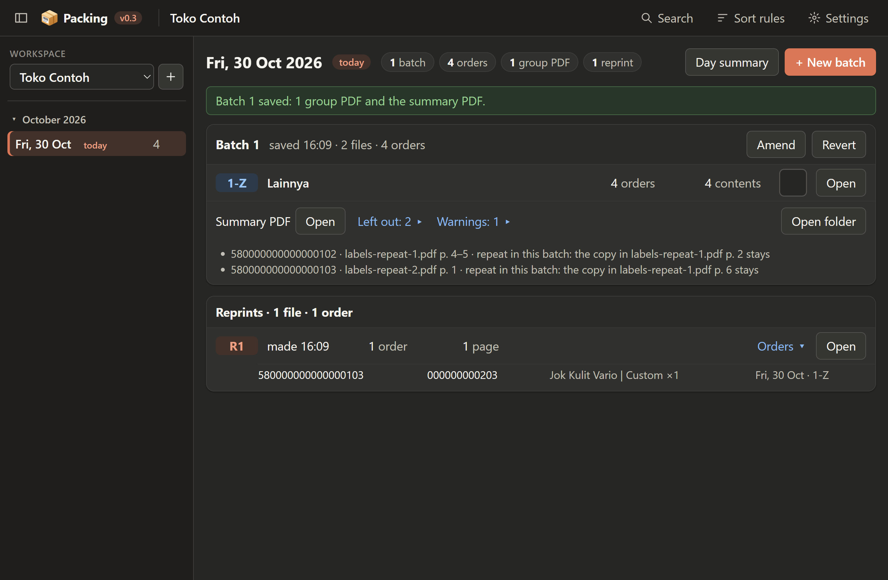

# Find and reprint a saved order (Search)

**Search** opens over the screen; **Close** returns. Searching changes nothing.

- Build the filter with the same boxes as the sort rules. The first box is *Tracking ID contains*, so a
  part of an ID is enough, e.g. *Tracking ID contains 00000012*.
  The first box has the cursor when Search opens, and **Enter** searches: scan a parcel's barcode and
  its order is found at once.
- **Dates**: **Viewed day** (the date the Day screen shows, the default; not listed when that is today),
  **Today**, **Yesterday**, **Last 7 days**, **Last 30 days**, **Custom range** (pick the first and last
  date) or **All days** of the workspace, then **Search**: "3 orders in 2 batches" and one row per order.
  **Order**: the Order ID over the courier and the tracking ID. **Items**, with the most room. **Label**:
  the date and the group code over the group's name and the **page** the label is on (to find the printed
  label in its stack). **Open** opens that group PDF; the arrow shows the batch's save time and the label
  file it was read from, with its pages. In a narrow window the items move under the order.
- **Courier**: *equals* picks one courier from the list; *contains* or *starts with* takes typed text, so
  `J&T` finds J&T Express and J&T Cargo.
- An order printed again before carries **Reprinted** under **Open**; point at it to see which reprint and when.
- Tick the orders to print again: click a row, or its tick; **Select all** ticks every order or none. A
  search that finds one order ticks it. A double click or a drag selects text to copy (an Order ID, a
  tracking ID) and leaves the tick alone.
- The bar at the foot says how many are selected and has **Reprint 2 orders**: one PDF of their label
  pages, in their original printing order, checked like a save, written into today: "Reprint 1 written:
  2 orders, 2 pages." with **Open**. When one of them was reprinted before, the app asks first. The
  orders stay in their batches; today's Day screen lists it under **Reprints**.

Back to [the guide](README.md) · the daily work: [A day](02-a-day.md).
